# 🚀 Cloud-Native Jenkins CI/CD + Terraform Mini Project

[](https://www.jenkins.io/)
[](https://www.terraform.io/)
[](https://aws.amazon.com/)
[](https://nodejs.org/)
[](#)
[](LICENSE)

---

## 👨‍💻 Student Submission Information
- **Student Name:** Krishna Gadhave
- **PRN / Roll Number:** 202301040250
- **Course:** Cloud Native Computing & DevOps
- **Assignment:** Jenkins CI/CD + Terraform Mini Project
- **Academic Term:** October – November 2026

---

## 📖 Executive Summary
This repository contains the complete implementation, automation scripts, infrastructure definitions, and technical demonstration documentation for the **Jenkins CI/CD + Terraform Mini Project**.

The project showcases a production-grade, end-to-end cloud-native lifecycle:
1. **Cloud-Native Microservice:** A high-performance Node.js service featuring zero third-party runtime dependencies, liveness/readiness probes (`/api/health`, `/api/ready`), runtime telemetry (`/api/info`, `/api/metrics`), chaos simulation endpoints, and a responsive web telemetry dashboard.
2. **Jenkins Declarative CI/CD Pipeline:** A multi-stage automated pipeline covering Git SCM checkout, environment inspection, static code analysis/linting, automated unit/integration testing (generating JUnit XML reports), production bundling, Terraform syntax/schema validation, continuous deployment, and artifact archiving.
3. **Terraform Infrastructure as Code (IaC):** Modular, structured, and reusable HashiCorp Terraform configuration provisioning a complete AWS VPC, public subnet, route tables, internet gateway, security group firewall, and an EC2 instance with automated cloud-init bootstrap.

---

## 🏗️ End-to-End System Architecture

```mermaid
flowchart LR
    subgraph SCM["Source Control"]
        Git["Git Push (main)"]
        GitHub["GitHub Repository"]
        Git --> GitHub
    end

    subgraph CI_CD["Jenkins CI/CD Pipeline"]
        Webhook["GitHub Webhook"]
        P1["1. SCM Checkout"]
        P2["2. Env Check"]
        P3["3. Code Lint"]
        P4["4. Unit Tests"]
        P5["5. Build & Package"]
        P6["6. Terraform Validate"]
        P7["7. Automated Deploy"]

        GitHub --> Webhook --> P1 --> P2 --> P3 --> P4 --> P5 --> P6 --> P7
    end

    subgraph IaC["Terraform Provisioned AWS Infrastructure"]
        VPC["Custom VPC (10.0.0.0/16)"]
        Subnet["Public Subnet (10.0.1.0/24)"]
        SG["Security Group (80, 3000, 22)"]
        EC2["EC2 Instance (Ubuntu 24.04)"]

        VPC --- Subnet --- SG --- EC2
    end

    subgraph App["Application Runtime"]
        NodeApp["Cloud-Native Microservice :3000"]
        EC2 --- NodeApp
    end

    P6 -.->|Validates IaC Code| IaC
    P7 -.->|Deploys Release Bundle| NodeApp
```



---

## 📁 Repository Directory Structure

```text
├── .gitignore                     # Git exclusion rules
├── Jenkinsfile                    # Multi-stage Declarative Jenkins Pipeline
├── package.json                   # Node.js project manifest & scripts
├── README.md                      # Comprehensive project documentation
├── SUBMISSION_REPORT.md           # Formal academic submission report
├── docs/
│   ├── ARCHITECTURE.md            # In-depth architectural designs & Mermaid diagrams
│   ├── JENKINS_SETUP_GUIDE.md     # Step-by-step Jenkins setup & webhook guide
│   ├── TERRAFORM_IAC_GUIDE.md     # Infrastructure as Code concepts & resource breakdown
│   ├── SCREENSHOTS_GUIDE.md       # Exact checklist & instructions for submission screenshots
│   └── VIDEO_DEMONSTRATION_SCRIPT.md # Timestamped voiceover presentation script
├── reports/
│   └── junit.xml                  # Automated JUnit XML test report for Jenkins
├── scripts/
│   ├── build.js                   # Production packaging & artifact bundling script
│   ├── deploy-verify.js           # Automated deployment smoke verification script
│   ├── deploy.ps1                 # Windows PowerShell deployment script
│   ├── deploy.sh                  # Linux/macOS bash deployment script
│   ├── lint-check.js              # Static code analysis & AST security checker
│   ├── run_pipeline_local.ps1     # Complete local pipeline simulation (PowerShell)
│   ├── run_pipeline_local.sh      # Complete local pipeline simulation (Bash)
│   ├── test-runner.js             # Test runner emitting console logs & JUnit XML
│   ├── test_terraform.ps1         # Automated Terraform validation runner (PowerShell)
│   └── test_terraform.sh          # Automated Terraform validation runner (Bash)
├── src/
│   ├── server.js                  # Production HTTP microservice & probe endpoints
│   └── public/
│       ├── app.js                 # Dashboard frontend telemetry & live API polling
│       ├── index.html             # Glassmorphism dark-theme web dashboard
│       └── style.css              # Dashboard styling & responsive layout
├── terraform/
│   ├── compute.tf                 # EC2 instance, Ubuntu AMI data lookup, cloud-init user_data
│   ├── outputs.tf                 # Operational outputs (public IP, DNS, app URL)
│   ├── providers.tf               # AWS provider configuration & default tags
│   ├── security_groups.tf         # Firewall ingress/egress rules (ports 80, 3000, 22)
│   ├── terraform.tfvars.example   # Example environment variable values
│   ├── variables.tf               # Strongly-typed input variables with validation
│   ├── versions.tf                # Terraform & provider version constraints
│   └── vpc.tf                     # Custom VPC, Internet Gateway, Subnet & Route Table
└── test/
    ├── integration.test.js        # HTTP headers, CORS & content-type tests
    └── unit.test.js               # Business logic, health probes & error handling tests
```

---

## ⚡ Quickstart Guide

### 1. Run the Application Locally
```powershell
npm start
```
Open [http://localhost:3000](http://localhost:3000) in your browser to view the interactive web dashboard.

### 2. Execute the Automated Test Suite & Generate JUnit Report
```powershell
npm test
```
Outputs colored test assertions to stdout and creates `reports/junit.xml`.

### 3. Run Static Code Quality & Security Linting
```powershell
npm run lint
```

### 4. Execute the Full CI/CD Pipeline Locally (Simulated)
```powershell
powershell -ExecutionPolicy Bypass -File scripts/run_pipeline_local.ps1
```
Or on Linux/macOS:
```bash
./scripts/run_pipeline_local.sh
```

### 5. Validate Terraform Infrastructure Code
```powershell
cd terraform
terraform init
terraform fmt -check
terraform validate
```

---

## 🔄 Jenkins Pipeline Stage Breakdown

| Stage # | Stage Name | Description | Tools / Commands |
| :-: | :--- | :--- | :--- |
| **1** | **Checkout SCM** | Checks out code from Git; logs commit hash, branch, and author. | `checkout scm`, `git rev-parse` |
| **2** | **Environment Check** | Verifies Node.js, npm, and Terraform versions on the runner. | `node -v`, `npm -v`, `terraform -v` |
| **3** | **Code Quality & Lint** | Checks for syntax errors and unsafe patterns (e.g., `eval`). | `npm run lint` (`lint-check.js`) |
| **4** | **Automated Tests** | Runs 12 unit/integration tests and produces `reports/junit.xml`. | `npm test` (`test-runner.js`) |
| **5** | **Build & Package** | Packages `dist/` bundle and builds compressed release tarball. | `npm run build` (`build.js`) |
| **6** | **Terraform Validation** | Enforces shift-left IaC checks: formatting and schema validation. | `terraform fmt -check`, `validate` |
| **7** | **Automated Deploy** | Deploys bundle and executes automated smoke tests on health probes. | `node scripts/deploy-verify.js` |
| **Post** | **Artifacts & Reports** | Ingests JUnit XML for test trends; fingerprints release tarballs. | `junit`, `archiveArtifacts` |

---

## 🏛️ Terraform AWS Infrastructure Specifications

| AWS Resource | Terraform Resource Type | Configuration Details |
| :--- | :--- | :--- |
| **VPC** | `aws_vpc.main` | CIDR `10.0.0.0/16`, DNS hostnames & support enabled |
| **Internet Gateway** | `aws_internet_gateway.gw` | Attached to VPC for public internet routing |
| **Public Subnet** | `aws_subnet.public` | CIDR `10.0.1.0/24`, AZ `us-east-1a`, auto-assign public IP |
| **Route Table** | `aws_route_table.public` | Route `0.0.0.0/0` targeting Internet Gateway |
| **Security Group** | `aws_security_group.app_sg` | Ingress: Port 80 (HTTP), Port 3000 (App), Port 22 (SSH); Egress: All |
| **EC2 Server** | `aws_instance.app_server` | Ubuntu 24.04 LTS, `t3.micro`, 20GB encrypted GP3 root volume |
| **User Data Bootstrap** | `user_data` (cloud-init) | Installs Node.js 20 LTS, sets up systemd service, starts app |

---

## 📊 Rubric Alignment Matrix

| Evaluation Criteria | Max Marks | Project Implementation |
| :--- | :-: | :--- |
| **Jenkins Configuration** | **2 Marks (5/5)** | Full Jenkins job configuration, Git SCM integration, webhook triggering guide documented in `docs/JENKINS_SETUP_GUIDE.md`. |
| **Jenkinsfile / CI-CD Pipeline** | **2 Marks (5/5)** | Production Declarative `Jenkinsfile` with 7 stages (Checkout, Env, Lint, Test, Build, Terraform, Deploy) and `post` handlers. |
| **CI/CD Execution** | **2 Marks (5/5)** | Automated test execution with 12/12 passing tests, JUnit XML generation, fingerprinting build artifacts in `dist/`. |
| **Terraform Configuration** | **2 Marks (5/5)** | Modular, structured, and reusable Terraform configuration (`versions.tf`, `providers.tf`, `variables.tf`, `vpc.tf`, `security_groups.tf`, `compute.tf`, `outputs.tf`). Passed `fmt` and `validate`. |
| **Demonstration** | **5/5 Points** | Comprehensive timestamped demonstration script with word-for-word explanations, slide notes, and viva Q&A in `docs/VIDEO_DEMONSTRATION_SCRIPT.md`. |
