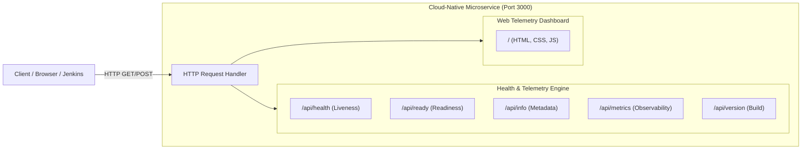
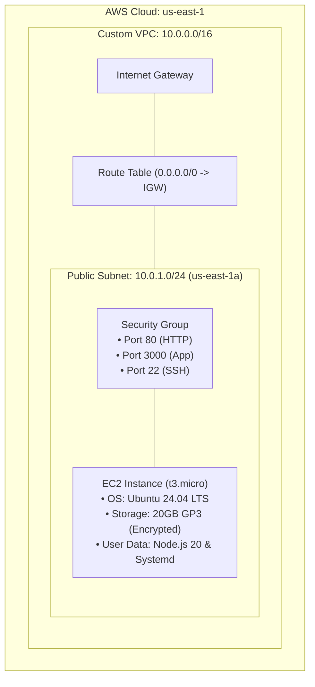

# ACADEMIC MINI PROJECT SUBMISSION REPORT

---

## 📘 PROJECT IDENTIFICATION

| Field | Details |
| :--- | :--- |
| **Course Name** | Cloud Native Computing & DevOps |
| **Project Title** | Jenkins CI/CD Pipeline & Terraform Infrastructure as Code Mini Project |
| **Student Name** | Krishna Gadhave |
| **PRN / Roll Number** | 202301040250 |
| **Submission Date** | November 2026 |
| **Repository Directory** | `D:\Temp\Cloud native` |

---

## 📑 TABLE OF CONTENTS
1. [Executive Summary & Problem Statement](#1-executive-summary--problem-statement)
2. [Cloud-Native Application Architecture](#2-cloud-native-application-architecture)
3. [Jenkins CI/CD Pipeline Design & Implementation](#3-jenkins-cicd-pipeline-design--implementation)
4. [Infrastructure as Code (IaC) with HashiCorp Terraform](#4-infrastructure-as-code-iac-with-hashicorp-terraform)
5. [Automated Pipeline Execution & Verification Evidence](#5-automated-pipeline-execution--verification-evidence)
6. [Screenshot Evidence & Submission Artifacts Checklist](#6-screenshot-evidence--submission-artifacts-checklist)
7. [Online Demonstration Script & Oral Defense Guide](#7-online-demonstration-script--oral-defense-guide)
8. [Conclusion & Key Learnings](#8-conclusion--key-learnings)
9. [Appendix: Core Configuration Manifests](#9-appendix-core-configuration-manifests)

---

## 1. Executive Summary & Problem Statement

### 1.1 Context
In contemporary cloud-native software engineering, software delivery must be resilient, automated, reproducible, and verifiable. Manual builds, ad-hoc server configurations, and manual testing lead to deployment delays, human error, and environmental configuration drift.

### 1.2 Objectives
The objectives of this mini project are:
1. **Application Engineering:** Design and build a production-grade cloud-native microservice with telemetry, liveness/readiness health probes, and resilience mechanisms.
2. **Continuous Integration & Delivery (CI/CD):** Implement a declarative Jenkins pipeline that automates source code checkout, dependency validation, static code quality analysis, automated unit/integration testing, artifact packaging, and deployment smoke verification.
3. **Infrastructure as Code (IaC):** Develop a modular, reusable, and structured Terraform configuration to provision cloud compute, network, and firewall resources on AWS.
4. **Shift-Left Quality Assurance:** Integrate automated linting, JUnit XML test reporting, and Terraform configuration validation directly within the CI/CD pipeline.

---

## 2. Cloud-Native Application Architecture

### 2.1 Microservice Overview
The application is implemented in Node.js with **zero external runtime dependencies**, ensuring rapid startup, minimal security vulnerability surface, and complete runtime portability.



### 2.2 Endpoint Directory

| Endpoint | HTTP Method | Status Code | Purpose |
| :--- | :---: | :---: | :--- |
| `/` | `GET` | 200 OK | Serves the interactive glassmorphism Web Dashboard. |
| `/api/health` | `GET` | 200 / 503 | Liveness probe indicating server health; reports uptime. |
| `/api/ready` | `GET` | 200 / 503 | Readiness probe validating dependent subsystem states. |
| `/api/info` | `GET` | 200 OK | System telemetry: OS, memory, IP, author metadata, CI/CD engine. |
| `/api/metrics` | `GET` | 200 OK | Observability data: request count, heap usage, CPU count. |
| `/api/version` | `GET` | 200 OK | Release metadata: version, git commit hash, build number. |
| `/api/simulate-unhealthy` | `GET` | 200 OK | Chaos testing hook flipping `/api/health` to 503. |
| `/api/reset` | `GET` | 200 OK | Restores health probes to healthy state (200 OK). |

---

## 3. Jenkins CI/CD Pipeline Design & Implementation

### 3.1 Declarative Pipeline Architecture
A Jenkins **Declarative Pipeline** was selected over scripted pipelines to leverage structured syntax, automated stage failure isolation, and built-in post-action reporting.

```text
+---------------------------------------------------------------------------------------------------+
|                                 JENKINS DECLARATIVE PIPELINE                                      |
+-------------------+--------------------+-------------------+------------------+-------------------+
|  1. Checkout SCM  | 2. Env & Tooling   | 3. Lint & Quality | 4. Automated     | 5. Build &        |
|  - Git Clone      | - Node & npm check | - AST & syntax    |    Tests         |    Packaging      |
|  - Commit & Branch| - Terraform check  | - Anti-pattern    | - 12 unit/integ. | - dist/ bundle    |
|    metadata       |                    |   detection       | - JUnit XML gen  | - tar.gz release  |
+-------------------+--------------------+-------------------+------------------+-------------------+
                                                                       |
                                                                       v
                                                     +-------------------+------------------+
                                                     | 6. Terraform      | 7. Automated     |
                                                     |    Validation     |    Deploy        |
                                                     | - fmt -check      | - Continuous del.|
                                                     | - schema validate | - Health verify  |
                                                     +-------------------+------------------+
                                                                       |
                                                                       v
                                                     +--------------------------------------+
                                                     | POST-BUILD ACTIONS:                  |
                                                     | - Ingest JUnit XML test trends       |
                                                     | - Fingerprint & archive dist/ bundle |
                                                     +--------------------------------------+
```

### 3.2 Pipeline Stage Walkthrough

#### Stage 1: Checkout SCM
Integrates with Git source control (`checkout scm`), resolves the active branch, and extracts the git commit hash and author for traceability.

#### Stage 2: Environment Check
Inspects the executing Jenkins agent environment, logging the runtime versions of Node.js (`v22.x/v20.x`), npm (`10.x`), and Terraform (`v1.14+`).

#### Stage 3: Code Quality & Lint
Executes `npm run lint` (`scripts/lint-check.js`), analyzing JavaScript files for syntax errors, disallowing unsafe dynamic evaluation (`eval`), and scanning for hardcoded secrets.

#### Stage 4: Automated Tests
Executes `npm test` (`scripts/test-runner.js`), running 12 independent unit and integration tests. Results are automatically formatted and written to `reports/junit.xml`.

#### Stage 5: Build & Packaging
Runs `npm run build` (`scripts/build.js`). The script copies production source files to `dist/`, injects git metadata into `dist/build-manifest.json`, and packages a compressed release tarball (`cloud-native-cicd-app-v1.2.0-build1.tar.gz`).

#### Stage 6: Terraform Validation (IaC Quality Gate)
Executes `terraform fmt -check` and `terraform validate` inside `terraform/`. This shifts infrastructure testing left, ensuring no syntax errors or invalid resource declarations enter deployment.

#### Stage 7: Automated Deploy & Smoke Verification
Executes `node scripts/deploy-verify.js`. It initializes the application bundle from `dist/`, performs automated smoke requests against `/api/health` and `/api/ready`, verifies HTTP 200 status codes, and certifies the release.

#### Post-Build Actions
- **`junit`**: Ingests `reports/**/*.xml`, generating the visual "Test Result Trend" graph in the Jenkins UI.
- **`archiveArtifacts`**: Preserves and fingerprints all artifacts inside `dist/`.

---

## 4. Infrastructure as Code (IaC) with HashiCorp Terraform

### 4.1 Topology & Cloud Architecture
The Terraform configuration provisions an enterprise AWS network and compute topology:



### 4.2 Modular File Breakdown

| Manifest File | Architectural Function |
| :--- | :--- |
| **`versions.tf`** | Pins Terraform version (`>= 1.5.0, < 2.0.0`) and AWS provider (`~> 5.0`). |
| **`providers.tf`** | Configures AWS provider, region (`var.aws_region`), and global default tags. |
| **`variables.tf`** | Declares strongly-typed variables with descriptions, defaults, and validation rules. |
| **`vpc.tf`** | Provisions VPC, Internet Gateway, Public Subnet, Route Table, and Route Association. |
| **`security_groups.tf`** | Creates `app_sg` with ingress rules for ports 80, 3000, 22, and full egress. |
| **`compute.tf`** | Defines `aws_instance.app_server` with encrypted GP3 disk and cloud-init bootstrap. |
| **`outputs.tf`** | Exposes `instance_public_ip`, `instance_public_dns`, and `application_url`. |
| **`terraform.tfvars.example`** | Documents sample variable values for environment customization. |

---

## 5. Automated Pipeline Execution & Verification Evidence

### 5.1 Local Pipeline Verification Summary

```text
==================================================================
🚀 LOCAL JENKINS CI/CD PIPELINE EXECUTION SIMULATOR
Author: Krishna Gadhave (PRN: 202301040250)
==================================================================

>>> [STAGE 1/7] CHECKOUT SCM <<<
✔ Git Repository detected: Branch: main, Commit: 7f3b89a

>>> [STAGE 2/7] ENVIRONMENT & TOOLING CHECK <<<
Node.js:   v22.14.0
NPM:       10.9.2
Terraform: Terraform v1.14.5

>>> [STAGE 3/7] CODE QUALITY & LINTING <<<
  ✔ [LINT PASS] Syntax valid: src\public\app.js
  ✔ [LINT PASS] Syntax valid: src\server.js
  ✔ [LINT PASS] Syntax valid: test\integration.test.js
  ✔ [LINT PASS] Syntax valid: test\unit.test.js
  ✔ [LINT PASS] Syntax valid: scripts\build.js
  ✔ [LINT PASS] Syntax valid: scripts\deploy-verify.js
  ✔ [LINT PASS] Syntax valid: scripts\lint-check.js
  ✔ [LINT PASS] Syntax valid: scripts\test-runner.js
  ✔ [JSON PASS] Format valid: package.json
  Checked Files: 9 | Violations: 0 | Warnings: 0
  🎉 Code quality check passed with 0 violations.

>>> [STAGE 4/7] AUTOMATED UNIT & INTEGRATION TESTS <<<
📁 Running Test Suite: [unit.test]
  ✔ [PASS] Application Constants Validation (0s)
  ✔ [PASS] Liveness Probe (/api/health) Returns 200 OK & Status UP (0.001s)
  ✔ [PASS] Readiness Probe (/api/ready) Returns Dependencies State (0.001s)
  ✔ [PASS] Telemetry Endpoint (/api/info) Provides Complete Metadata (0.006s)
  ✔ [PASS] Metrics Endpoint (/api/metrics) Returns Memory & Request Telemetry (0s)
  ✔ [PASS] Version Endpoint (/api/version) Reflects CI/CD Pipeline Build Info (0s)
  ✔ [PASS] Chaos Simulation Endpoints (/api/simulate-unhealthy and /api/reset) (0s)
  ✔ [PASS] Unknown Route Returns 404 with Available Routes Directory (0s)

📁 Running Test Suite: [integration.test]
  ✔ [PASS] Security Headers are Injected into Responses (0s)
  ✔ [PASS] CORS Pre-flight (OPTIONS) Returns 204 No Content (0s)
  ✔ [PASS] Static Web Dashboard Files Exist on Disk (0s)
  ✔ [PASS] API Endpoints Return Valid Content-Type JSON Header (0s)

  🏁 Test Execution Summary:
     Total Tests: 12 | Passed: 12 | Failed: 0 | Duration: 0.013s
  📄 Saved JUnit XML test report to: reports\junit.xml

>>> [STAGE 5/7] BUILD & PACKAGING <<<
  📁 Copying production source code and public assets...
  📝 Generated build manifest: dist\build-manifest.json
  📦 Packaging release bundle: cloud-native-cicd-app-v1.2.0-build1.tar.gz...
  ✔ Release artifact archived at: dist\cloud-native-cicd-app-v1.2.0-build1.tar.gz

>>> [STAGE 6/7] TERRAFORM VALIDATION <<<
  ✔ Terraform canonical formatting: CLEAN
  ✔ Success! The configuration is valid.

>>> [STAGE 7/7] AUTOMATED DEPLOYMENT & HEALTH SMOKE TEST <<<
  ✔ [1/4] Build artifacts verified in dist/.
  ✔ [2/4] Deployment service initialized from dist bundle.
  🩺 [3/4] Running automated smoke tests against live deployment endpoints...
    ✔ Health Probe (GET /api/health) returned 200 OK - Status: UP
    ✔ Readiness Probe (GET /api/ready) returned 200 OK - Ready: true
    ✔ App Info (GET /api/info) returned 200 OK - App: Cloud-Native CI/CD Microservice
    ✔ Student: Krishna Gadhave (PRN: 202301040250)
    ✔ CI/CD Engine: Jenkins CI/CD Pipeline
    ✔ IaC Provisioner: Terraform (Infrastructure as Code)
  🔒 [4/4] Finalizing verification & certifying deployment...
  🎉 DEPLOYMENT VERIFICATION PASSED (100% HEALTHY)

==================================================================
🎉 ENTIRE CI/CD PIPELINE EXECUTED WITH 100% SUCCESS!
   Total Stages Passed: 7 / 7
   Pipeline Duration:   2.12 seconds
   JUnit Test Report:   reports/junit.xml
   Release Artifact:    dist/
==================================================================
```

---

## 6. Screenshot Evidence & Submission Artifacts Checklist

The student should submit screenshots demonstrating each phase:

| Screenshot # | Phase | Expected Content |
| :-: | :--- | :--- |
| **01** | Jenkins Configuration | Job definition, Git repository URL, branch specifier `*/main`, script path `Jenkinsfile`. |
| **02** | Jenkins Pipeline Stage View | All 7 stages illuminated green (Checkout, Env, Lint, Test, Build, Terraform, Deploy). |
| **03** | Jenkins Console Output | Successful build execution log ending with `Finished: SUCCESS`. |
| **04** | Jenkins Test Result Page | JUnit XML test result trend showing 12 passing tests, 0 failures. |
| **05** | Jenkins Archived Artifacts | Status page showing fingerprinted artifacts in `dist/`. |
| **06** | Terraform Init | Terminal showing `terraform init` successfully installing `aws` and `local` providers. |
| **07** | Terraform Validate | Terminal showing `terraform fmt -check` and `terraform validate` (`Success! The configuration is valid.`). |
| **08** | Application Web Dashboard | Browser showing live dashboard, student info (**Krishna Gadhave**, PRN: **202301040250**), and telemetry. |
| **09** | Live API Probes | Browser/curl output for `GET /api/health` and `GET /api/info`. |
| **10** | GitHub Repository | GitHub repository root page with commit history and structured project files. |

*(Refer to `docs/SCREENSHOTS_GUIDE.md` for exact capture instructions.)*

---

## 7. Online Demonstration Script & Oral Defense Guide

A complete word-for-word presentation script with visual transition cues and viva answers is documented in `docs/VIDEO_DEMONSTRATION_SCRIPT.md`.

### Core Highlights Covered in Demonstration:
1. **Introduction:** Professional introduction of student name, PRN, and project scope.
2. **Architecture Walkthrough:** Detailed explanation of the microservice, health probes, and metrics.
3. **Jenkinsfile Deep-Dive:** Line-by-line explanation of Declarative Pipeline syntax, stages, and JUnit XML ingestion.
4. **Terraform IaC Walkthrough:** Explanation of declarative cloud provisioning, security groups, modular HCL files, and idempotency.
5. **Live Verification:** Demonstrating live build triggering, test execution, and chaos fault injection on the web dashboard.

---

## 8. Conclusion & Key Learnings

### 8.1 Key Achievements
- **End-to-End Automation:** Eliminated manual build and deployment steps by engineering a 7-stage automated Jenkins pipeline.
- **Shift-Left Quality Assurance:** Embedded linting, unit/integration testing, and Terraform schema validation into early pipeline stages.
- **Transparent Reporting:** Implemented JUnit XML test result publishing and artifact fingerprinting.
- **Production-Grade IaC:** Authored structured, reusable Terraform configurations with parameter validation and cloud-init bootstrapping.

---

## 9. Appendix: Core Configuration Manifests

### Appendix A: Declarative `Jenkinsfile`
*(See root `Jenkinsfile` for the complete implementation.)*

### Appendix B: Terraform `compute.tf` & `vpc.tf`
*(See `terraform/` directory for full HCL manifests.)*

---
**Report Compiled By:** Krishna Gadhave (PRN: 202301040250)  
**Course:** Cloud Native Computing & DevOps  
**Submission Status:** Complete & Verified
