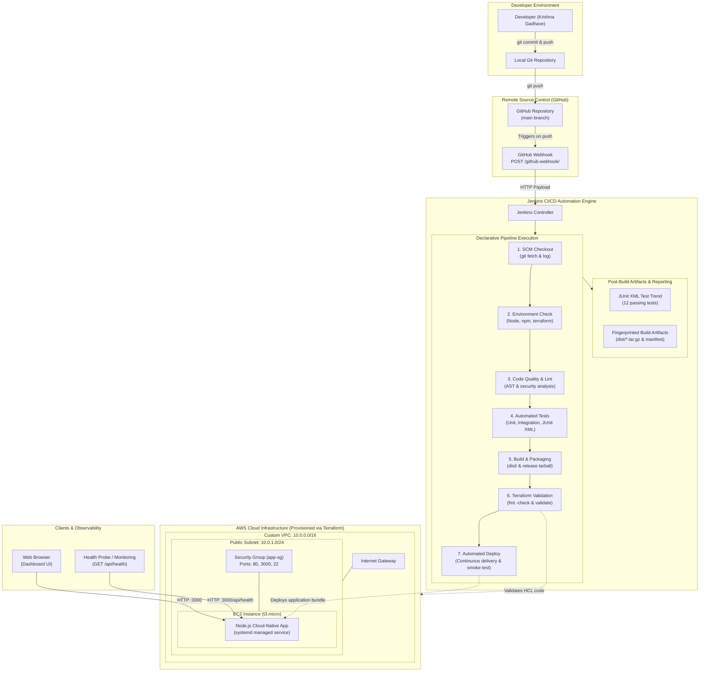
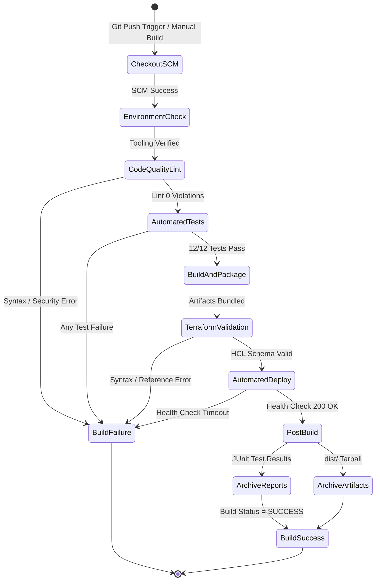
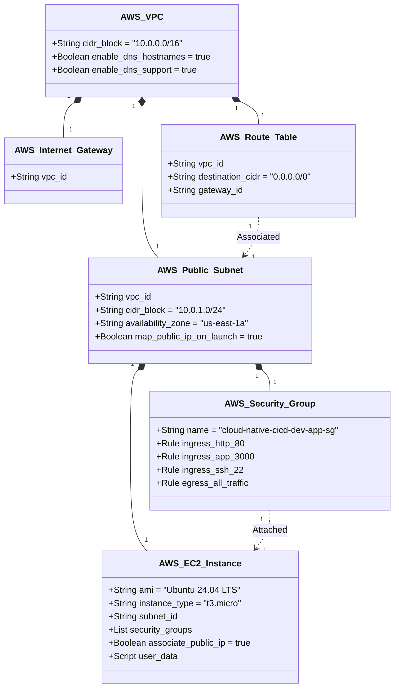
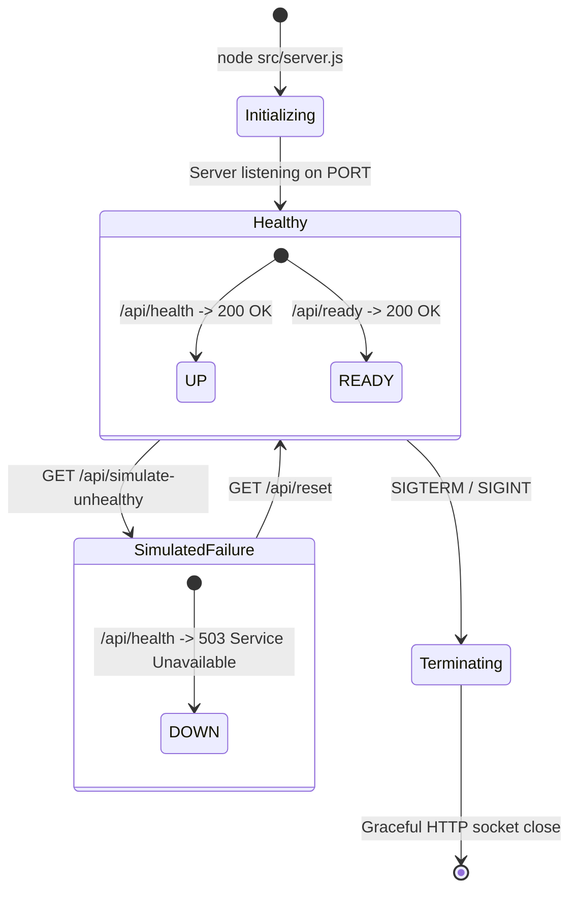

# 🏗️ System Architecture & Engineering Specifications

**Project:** Cloud Native Jenkins CI/CD + Terraform Mini Project  
**Author:** Krishna Gadhave (PRN: 202301040250)  
**Course:** Cloud Native Computing & DevOps  

---

## 1. End-to-End System Architecture

---

## 2. Jenkins Declarative Pipeline Lifecycle

---

## 3. Terraform Cloud Infrastructure Topology

---

## 4. Microservice Health Probe & State Transitions

