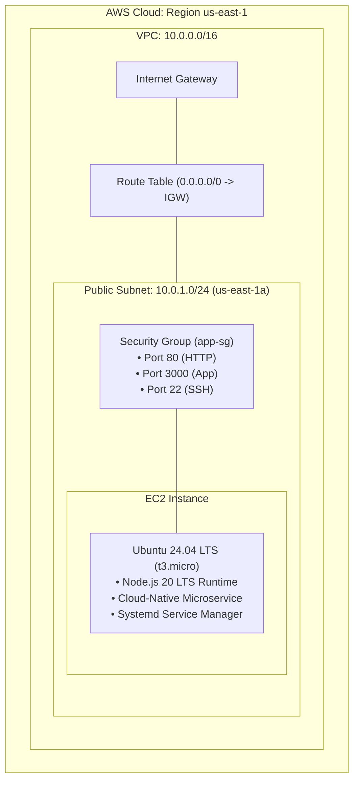

# 🏗️ Terraform Infrastructure as Code (IaC) Guide

**Project:** Cloud Native Jenkins CI/CD + Terraform Mini Project  
**Author:** Krishna Gadhave (PRN: 202301040250)  
**Course:** Cloud Native Computing & DevOps  

---

## 📌 1. What is Infrastructure as Code (IaC)?
Infrastructure as Code (IaC) is the practice of managing and provisioning computer data center infrastructure through machine-readable definition files, rather than physical hardware configuration or interactive configuration tools.

### Core Benefits of IaC:
1. **Idempotency:** Applying the same configuration repeatedly always produces the identical target state.
2. **Version Control:** Infrastructure definitions are stored in Git, enabling code reviews, history tracking, and rollback capabilities.
3. **Consistency & Elimination of Drift:** Eliminates human manual error and configuration discrepancies across development, staging, and production environments.
4. **Automated Provisioning:** Reduces deployment lead time from days to minutes.

---

## 🏛️ 2. Architectural Resource Breakdown

This project provisions an enterprise cloud architecture on AWS using modular and structured Terraform HCL files:



### Detailed File Responsibilities:

| File | Purpose | Key Constructs |
| :--- | :--- | :--- |
| **`versions.tf`** | Declares required Terraform version and provider source constraints. | `terraform { required_version, required_providers }` |
| **`providers.tf`** | Configures the AWS provider, target region, and default metadata tags. | `provider "aws" { default_tags }` |
| **`variables.tf`** | Defines strongly typed inputs with validation rules and descriptions. | `variable "environment" { validation { ... } }` |
| **`vpc.tf`** | Provisions network isolation: Custom VPC, Subnet, Internet Gateway, Route Table. | `aws_vpc`, `aws_subnet`, `aws_internet_gateway` |
| **`security_groups.tf`** | Implements defense-in-depth network firewall ingress and egress rules. | `aws_security_group` (ports 80, 3000, 22) |
| **`compute.tf`** | Provisions the EC2 server, encrypted gp3 storage, and automated `user_data` bootstrap. | `aws_instance`, `data "aws_ami"` |
| **`outputs.tf`** | Exposes operational telemetry: Public IP, DNS, app URL, health probe URL. | `output "application_url"`, `output "vpc_id"` |
| **`terraform.tfvars.example`** | Documents sample configuration values for dev, staging, and production tiers. | Key-value variable assignments |

---

## 🔄 3. The Terraform Lifecycle

The standard HashiCorp Terraform workflow consists of four distinct phases:

1. **`terraform fmt -check`:** Verifies that all configuration files follow HashiCorp standard indentation and style rules.
2. **`terraform init`:** Initializes working directory, downloads required provider plugins (`aws`, `local`), and creates `.terraform.lock.hcl`.
3. **`terraform validate`:** Checks configuration syntax, resource references, and provider schemas without making remote cloud calls.
4. **`terraform plan`:** Reads current cloud state, compares it with the configuration code, and calculates an execution plan of additions, modifications, and deletions.
5. **`terraform apply`:** Executes the plan to reach the desired state.
6. **`terraform destroy`:** Safely removes all managed infrastructure resources.

---

## 🔒 4. State Management & Idempotency

### The Terraform State File (`terraform.tfstate`)
- Terraform records the mapping between your declared resources and real-world cloud IDs in a JSON state file.
- When you execute `terraform apply`, Terraform consults the state file to calculate differences rather than blindly recreating resources.

### State Locking
- In team environments, remote backends (like AWS S3 + DynamoDB) provide state locking to prevent concurrent apply operations from corrupting state.

---

## 🚀 5. Integration into the Jenkins CI/CD Pipeline

In this project, Terraform validation is directly embedded into **Stage 6** of the Jenkins Declarative Pipeline:

```groovy
stage('Terraform Validation') {
    steps {
        echo "Validating Infrastructure as Code (Terraform)"
        sh 'terraform -chdir=terraform fmt -check'
        sh 'terraform -chdir=terraform validate'
    }
}
```

This enforces **Shift-Left Infrastructure Quality**: Any syntax error, misconfigured CIDR block, or invalid variable in infrastructure code will fail the build before anything touches production!
